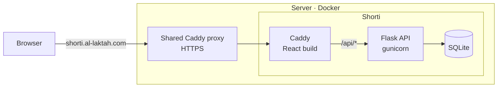

# Shorti

<p align="center">
    <a href="LICENSE">
        
    </a>
    <a>
        
    </a>
</p>


## Description:

A web app to shorten URLs and track how often they are clicked, live at [shorti.al-laktah.com](https://shorti.al-laktah.com).
The Frontend was bootstrapped with [Create React App](https://github.com/facebook/create-react-app).
The Backend was created using Flask, with SQLite for storage.

Originally built in 2021 for shorti.xyz and brought back in 2026: the dependencies were updated to run on current Python and Node, the domain was made configurable and the whole app was packaged with Docker.

## How it works:



Each URL is hashed with a random salt (SHA-256). The first five characters of the hash, randomly capitalised, become the short code, and on a collision it moves further along the hash.

Opening a short URL like `shorti.al-laktah.com/AbC12` loads the React app, which asks the API for the original URL (counting the click on the way) and sends the browser on to it.

| Endpoint | Body | Returns |
| --- | --- | --- |
| `POST /api/shortener/` | `{"url": "github.com"}` | The short URL |
| `GET /api/url/<code>` | | The original URL, and counts a click |
| `POST /api/clicks/` | `{"shorti": "shorti.al-laktah.com/AbC12"}` | How often it was clicked |

## Running locally:

Needs Python 3.10 or newer, and Node 18 or newer with Yarn 1 (`npm install -g yarn`).
The frontend and the API are started separately. The React dev server forwards `/api/` requests to Flask on port 4444.

```sh
# API
cd api
python3 -m venv venv
venv/bin/pip install -r requirements.txt
cd ..
yarn start-api

# Frontend (in a second terminal)
yarn install
yarn start
```

## Changing the domain:

The frontend has no domain baked in, it talks to the API on whatever domain it is served from.
The domain short URLs are generated under comes from the `SHORTI_DOMAIN` environment variable:

- With Docker: put `SHORTI_DOMAIN=example.com` in a `.env` file next to `docker-compose.yml`, run `docker compose up -d` and change the domain in the proxy's site block (see below).
- Running locally: `SHORTI_DOMAIN=localhost:3000 yarn start-api`, without it the default from [`api/config.py`](api/config.py) is used.

## Deployment:

Shorti runs with Docker Compose behind a shared [Caddy](https://caddyserver.com) proxy that takes care of HTTPS, so other services can run on the same server.
Inside, a second Caddy serves the frontend and forwards `/api/` to the Flask app.
The proxy has to be on a Docker network called `web` and send the domain to `shorti:80`:

```
shorti.al-laktah.com {
	reverse_proxy shorti:80
}
```

Then, with the domain's DNS pointing at the server, run:

```sh
docker compose up -d --build
```

Run the same command again after pulling new changes. The links are kept in the `shorti-data` volume, a copy of the database can be taken with:

```sh
docker compose cp api:/data/andy.db ./andy.db
```

The live version runs on an Oracle Cloud Always Free Arm VM, set up with Terraform in [al-laktah-cloud](https://github.com/al-laktah/al-laktah-cloud).

## Todo:

- Migrate DB from SQLite
- Add Dark mode
- Add Privacy and Terms
- Make the Contact and Report forms send their messages
- A proper page for short URLs that don't exist
- Improve the shortening algorithm

## License:

MIT, see [LICENSE](LICENSE).
